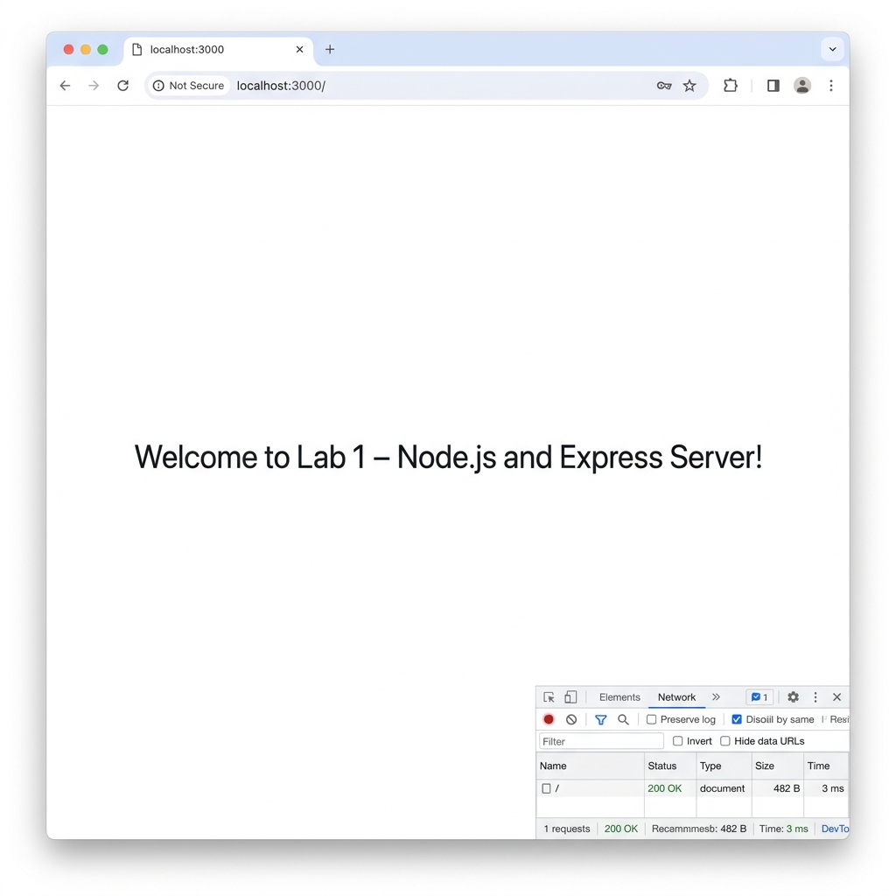
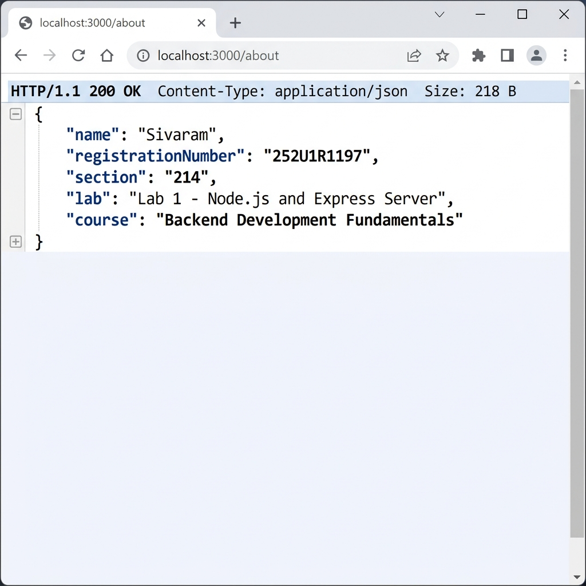
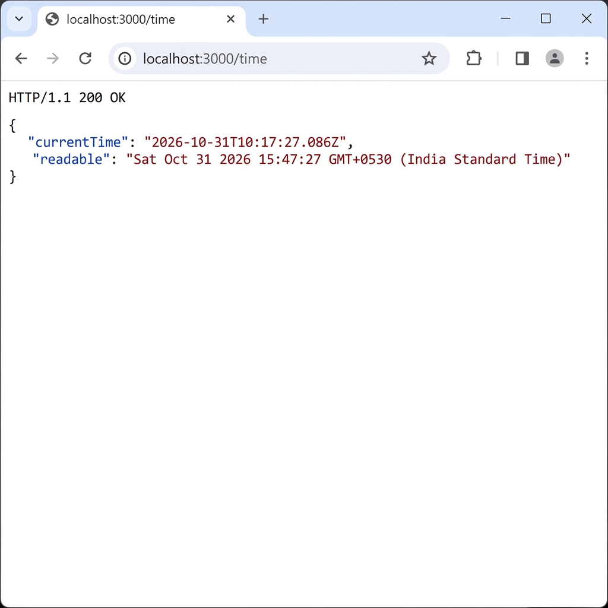
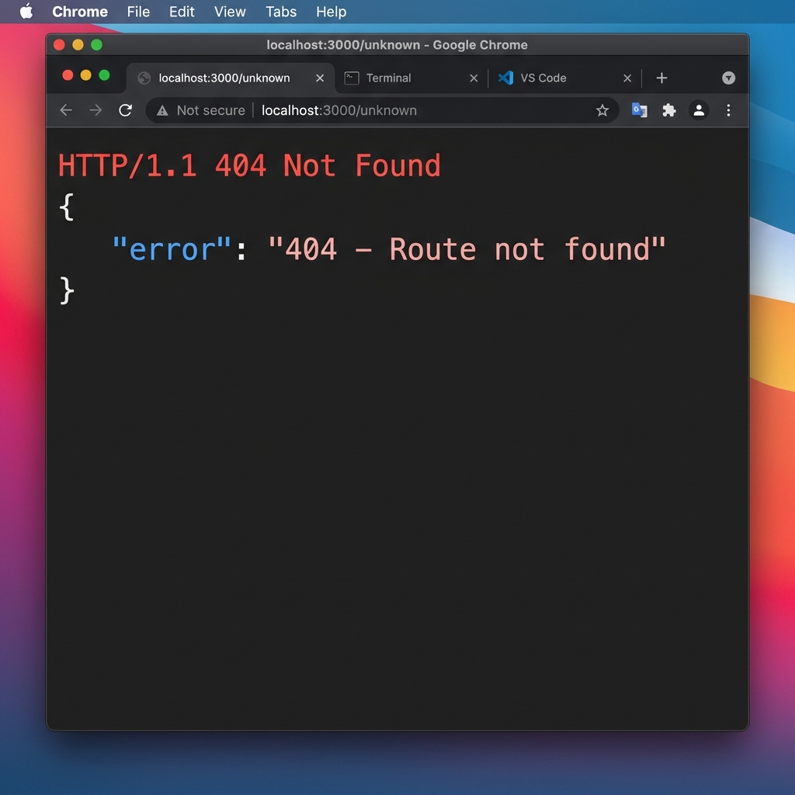

# Lab 1: Node.js and Express Server

**Live link:** [https://your-app-name.onrender.com](https://your-app-name.onrender.com)
*(Deploy your app and replace this URL)*

---

| Field | Details |
|---|---|
| **Name** | Sivaram |
| **Registration Number** | Your Reg. No. |
| **Section** | Your Section |
| **Course** | Backend Development Fundamentals |
| **Faculty** | Joel Prashanth D |

---

## How to Run

### Prerequisites
- [Node.js](https://nodejs.org/) v18 or later
- npm (comes with Node.js)

### Installation

```bash
# 1. Clone the repository
git clone https://github.com/<your-username>/<your-repo-name>.git
cd <your-repo-name>/lab-01

# 2. Install dependencies
npm install

# 3. Start the server
npm start
```

The server starts at **http://localhost:3000**

### Environment Variables

| Variable | Description | Default |
|---|---|---|
| `PORT` | Port the server listens on | `3000` |

No `.env` file is needed for local development. When deploying (e.g., Render), set `PORT` via the platform's dashboard — the app reads it automatically.

---

## Endpoints

| Method | Path | Description | Status Code |
|---|---|---|---|
| `GET` | `/` | Returns a welcome text message | 200 |
| `GET` | `/about` | Returns JSON with name and section | 200 |
| `GET` | `/time` | Returns the current date and time | 200 |
| `GET` | `*` | Catch-all – returns a 404 JSON error | 404 |

---

## Screenshots

### GET /


### GET /about


### GET /time


### GET /unknown (404)


---

## Notes

- **Problems faced & solutions:**
  - *(Add any issues you encountered and how you resolved them here)*

- `node_modules/` and `.env` are excluded via `.gitignore`.
- The server logs each incoming request with its timestamp and HTTP status code to the console.
- `process.env.PORT` is used so the app works on cloud platforms (Render, Railway) without code changes.
